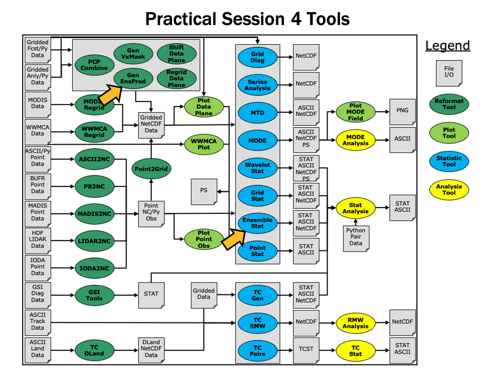

Session 4: Ensemble and PQPF
============================

**METplus Practical Session 4**

During this practical session, you will run the tools indicated below:

Since you already set up your runtime enviroment in Session 1, you should be ready to go! To be sure, run through the following instructions to check that your environment is set correctly.

**Prerequisites: Verify Environment is Set Correctly**

Before running the tutorial instructions, you will need to ensure that you have a few environment variables set up correctly. If they are not set correctly, the tutorial instructions will not work properly.

.. note::

   **1:** Navigate to your tutorial directory and run the tutorial setup script.

.. important::

   In the following instructions, change "/path/to" to the directory you chose.

**EDIT AFTER COPYING and BEFORE HITTING RETURN!**

.. code-block:: text

   cd /path/to/METplus-5.0.0_Tutorial
   source METplus-5.0.0_TutorialSetup.sh

.. note::

   **2:** Check that you have environment variables set correctly. If any of these variables are not set, navigate back to the METplus Setup section of the tutorial.

.. code-block:: text

   echo ${METPLUS_TUTORIAL_DIR}
   echo ${METPLUS_BUILD_BASE}
   echo ${MET_BUILD_BASE}
   echo ${METPLUS_DATA}
   ls ${METPLUS_TUTORIAL_DIR}
   ls ${METPLUS_BUILD_BASE}
   ls ${MET_BUILD_BASE}
   ls ${METPLUS_DATA}

.. important::

   **METPLUS_TUTORIAL_DIR** is the location of all of your tutorial work, including configuration files, output data, and any other notes you'd like to keep.
   **METPLUS_BUILD_BASE** is the full path to the METplus installation (/path/to/METplus-X.Y)
   **MET_BUILD_BASE** is the full path to the MET installation (/path/to/met-X.Y)
   **METPLUS_DATA** is the location of the sample test data directory

.. note::

   **3:** Check that the MET applications are in the path:

.. code-block:: text

   which point_stat

.. important::

   You should see the usage statement for Point-Stat. The version number listed should correspond to the version listed in **MET_BUILD_BASE**. If it does not, you will need to either reload the met module, or add **${MET_BUILD_BASE}/bin** to your PATH.

.. note::

   **4:** Check that the correct version of **run_metplus.py** is in your **PATH**:

.. code-block:: text

   which run_metplus.py

.. important::

   If you don't see the full path to script from the shared installation, please set it. It should look the same as the output from this command:

.. code-block:: text

   echo ${METPLUS_BUILD_BASE}/ush/run_metplus.py
   ls ${METPLUS_BUILD_BASE}/ush/run_metplus.py

See the instructions in Session 1 for more information.
You are now ready to move on to the next section.

.. important::

   If you discover any typos, error in the run commands, incorrect output listed, or any other issues while completing the tutorial, you are encouraged to submit your findings to the METplus team in a `GitHub Discussions. <https://github.com/dtcenter/METplus/discussions>`_ Be sure to provide what session and specific page you encountered the issue on.

.. _MET_tool_Gen-Ens-Prod:

MET Tool: Gen-Ens-Prod
----------------------

.. important::

   IMPORTANT NOTE: If you are returning to the tutorial, you must source the tutorial setup script before running the following instructions. If you are unsure if you have done this step, please navigate to the :ref:`Verify Environment is Set Correctly <verif_env_set_correct>` page.

**GEN-ENS-PROD FUNCTIONALITY**

The Gen-Ens-Prod tool may be used to generate simple ensemble products from the provided ensemble forecast members. If climatological mean and standard deviation data is provided, it can be used to set thresholds for the ensemble product generation at each grid point. This tool does not provide methods to generate statistical output from the ensemble members, nor does it allow comparisons. If this is the desired outcome, Gen-Ens-Prod output can be passed to additional MET tools for further verification steps.

**GEN-ENS-PROD USAGE**

View the usage statement for Gen-Ens-Prod by simply typing the following:

.. code-block:: text

   gen_ens_prod

**Usage: gen_ens_prod**

.. list-table::
   :header-rows: 1
   :widths: 30 70

   * - Argument
     - Description
   * - ``-ens file_1 ... file_n | ens_file_list``
     - Input gridded ensemble files to be used, or ASCII list of ensemble member file names.
   * - ``-out file``
     - netCDF output file.
   * - ``-config file``
     - GenEnsProd file containing the desired configuration settings.
   * - ``[-ctrl file]``
     - Contains the ensemble control data (optional).
   * - ``[-log file]``
     - Outputs log messages to the specified file (optional).
   * - ``[-v level]``
     - Level of logging (optional).

Gen-Ens-Prod has three required arguments. You can specify the list of ensemble files to be used either by entering the file name for each ensemble member file (-ens ens_file_1 ... ens_file_n) or as an ASCII file containing the names of the ensemble files to be used (ens_file_list). Choose whichever way is most convenient for you. The output netCDF file containing the requested ensemble products is set with -out file. Finally, -config file requires a configuration file for processing.
Gen-Ens-Prod has additional optional settings. These include the -ctrl file, allowing users to set an ensemble control member file. This file's data will be included for ensemble mean computations, but excluded for ensemble spread. Log messages created during runtime can be saved using -log file. And as seen in other MET tools, -v level will control the verbosity of the tool's log messages.

Configure
^^^^^^^^^

.. note::

   Start by making an output directory for Gen-Ens-Prod and changing directories:

.. code-block:: text

   mkdir -p ${METPLUS_TUTORIAL_DIR}/output/met_output/gen_ens_prod
   cd ${METPLUS_TUTORIAL_DIR}/output/met_output/gen_ens_prod

Similar to other MET tools, the behavior of Gen-Ens-Prod is controlled by the contents of the configuration file passed to it on the command line. The default Gen-Ens-Prod configuration file may be found in the `data/config/GenEnsProdConfig_default <https://github.com/dtcenter/MET/blob/main_v11.1/data/config/GenEnsProdConfig_default>`_ file. The configurations used by the test script may be found in the scripts/config/GenEnsProdConfig* files.

.. note::

   Prior to modifying the configuration file, users are advised to make a copy of the default:

.. code-block:: text

   cp ${MET_BUILD_BASE}/share/met/config/GenEnsProdConfig_default GenEnsProdConfig_tutorial

.. note::

   Open up the **GenEnsProdConfig_tutorial** file for editing with your preferred text editor.

.. code-block:: text

   vi GenEnsProdConfig_tutorial

The configurable items for Gen-Ens-Prod are a more limited version of those found in tools such as Grid-Stat and Point-Stat. The reason for this is tied to the purpose of the tool: Gen-Ens-Prod is for creating simple ensemble products and not for statistical verification with observation datasets. This is made clear in the configuration file's use of the ensemble ens dictionary, rather than a forecast and observation dictionary.

.. admonition:: File Contents

   .. code-block:: text

      ens = {
      ens_thresh = 1.0;
      vld_thresh = 1.0;
      field = [
      {
      name = "APCP";
      level = "A03";
      cat_thresh = [ >0.0, >=5.0 ];
      }
      ];
      }

The configuration file also does not have the ability to request statistical line type output, instead allowing users to create ensemble products with the ensemble_flag dictionary.

.. admonition:: File Contents

   .. code-block:: text

      ensemble_flag = {
      latlon = TRUE;
      mean = TRUE;
      stdev = TRUE;
      minus = TRUE;
      plus = TRUE;
      min = TRUE;
      max = TRUE;
      range = TRUE;
      vld_count = TRUE;
      frequency = TRUE;
      nep = FALSE;
      nmep = FALSE;
      climo = FALSE;
      climo_cdp = FALSE;
      }

.. important::

  You may find a complete description of the configurable items in the `gen_ens_prod configuration file <https://metplus.readthedocs.io/projects/met/en/main_v11.1/Users_Guide/gen-ens-prod.html#gen-ens-prod-configuration-file>`_ section of the MET User's Guide. Please take some time to review them.

For this tutorial, we'll configure Gen-Ens-Prod to create ensemble products for 24-hour accumulated precipitation. While we'll run Gen-Ens-Prod on a single field, please note that it may be configured to operate on multiple fields. The ensemble we're using consists of 6 members defined over the west coast of the United States.

.. note::

   In the **ens** dictionary, set

.. admonition:: File Contents

   .. code-block:: text

      ens = {
      ens_thresh = 0.5;
      vld_thresh = 0.5;
      field = [
      {
      name = "APCP";
      level = "A24";
      cat_thresh = [ >0.0, >=13.0, >=25.0, >=101.0];
      }
      ];
      }

Setting ens_thresh at 0.5 allows half of the ensemble member files being passed at runtime to contain invalid data and before GenEnsProd quits with an error. Similarly, vld_thresh at 0.5 allows each grid point to have invalid data for half of the ensemble member files passed at runtime and still compute the requested products for that grid point.

.. note::

   In the **ensemble_flag** dictionary, set

.. admonition:: File Contents

   .. code-block:: text

      ensemble_flag = {
      latlon = TRUE;
      mean = TRUE;
      stdev = TRUE;
      minus = FALSE;
      plus = FALSE;
      min = FALSE;
      max = FALSE;
      range = FALSE;
      vld_count = TRUE;
      frequency = TRUE;
      nep = FALSE;
      nmep = FALSE;
      climo = FALSE;
      climo_cdp = FALSE;
      }

These products will be output to the netCDF designated at runtime with the -out flag. They will show a small sample of the options from Gen-Ens-Prod, as well as highlighting how the output changes when one of the files is entered as the control ensemble member, which will be done later this session.

.. note::

   Save and close this file.

Run
^^^

.. note::

   Let's run Gen-Ens-Prod on the command line using the following command:

.. code-block:: text

   gen_ens_prod \
   -ens ${METPLUS_DATA}/met_test/data/sample_fcst/2009123112/*gep*/d01_2009123112_02400.grib \
   -out ./GenEnsProd_APCP24.nc \
   -config GenEnsProdConfig_tutorial \
   -v 2

Gen-Ens-Prod creates the products we requested in the configuration file, using the categorical thresholds specified. Note that we've passed the input ensemble data directly on the command line by specifying the ensemble member names using wildcards.
When Gen-Ens-Prod has completed running, there will be 1 netCDF output file, GenEnsProd_APCP24.nc

Output
^^^^^^

As mentioned previously, Gen-Ens-Prod only produces 1 netCDF output file. This file contains all of the requested products that were made in the configuration file.

.. note::

   Let's take a look at the contents of the file:

.. code-block:: text

   ncdump -h GenEnsProd_APCP24.nc

Note that the file contains 9 variables: the latitude and longitudes, the ensemble mean and standard deviation, the ensemble valid data count, and the four categorical thresholds that were set, all with the prefix ``APCP_24_A24_ENS_FREQ_``. These thresholds act as uncalibrated probability forecasts and can be verified against observational datasets with other MET tools.

.. note::

   Now let's visually inspect the file contents with a graphical viewer:

.. code-block:: text

   ncview GenEnsProd_APCP24.nc

Click through the variable names in the ncview window to see plots of the content we saw in the ncdump command.
Now that we've seen a successful run of the Gen-Ens-Prod tool, let's change the run command slightly to show how the -ctrl setting works.

Rerun
^^^^^

Now that we've seen the output for Gen-Ens-Prod without any control ensemble members, let's change the run slightly by selecting one of the previous ensemble members as the control. Because the required changes will be performed in the run command, no edits will be made to the configuration file.

.. note::

   Run the following command. Note the change to the wildcards, additional flag, and change in output file name:

.. code-block:: text

   gen_ens_prod \
   -ens ${METPLUS_DATA}/met_test/data/sample_fcst/2009123112/*gep[23567]/d01_2009123112_02400.grib \
   -out ./GenEnsProd_APCP24_run2_ctrl.nc \
   -config GenEnsProdConfig_tutorial \
   -ctrl ${METPLUS_DATA}/met_test/data/sample_fcst/2009123112/arw-fer-gep1/d01_2009123112_02400.grib \
   -v 2

When MET has successfully finished running, 1 new netCDF file will be in the current directory containing the same ensemble products that were available in the first run. However, the output is now changed by using one of the original ensemble members as the control member.

.. note::

   Take a look at the contents of the new netCDF file with ncview:

.. code-block:: text

   ncview GenEnsProd_APCP24_run2_ctrl.nc

You'll see as you click through the variables that the only difference between the two runs of Gen-Ens-Prod is APCP_24_A24_ENS_STDEV. The mean (APCP_24_A24_ENS_MEAN) and all of the categorical thresholds still use all 6 ensemble members. This is quickly confirmed by viewing APCP_24_A24_ENS_VLD for both, which shows 6 ensembles were used for both runs across the domain.
To better illustrate the difference in the APCP_24_A24_ENS_STDEV products, let's calculate the difference of the two fields using PCP-Combine, and plot the results using Plot-Data-Plane.

.. note::

   Use the following command to subtract the control standard deviation field from the full ensemble standard deviation field, saving it to the netCDF file and variable name provided:

.. code-block:: text

   pcp_combine -subtract \
   GenEnsProd_APCP24.nc 'name="APCP_24_A24_ENS_STDEV"; level="(*,*)";' \
   GenEnsProd_APCP24_run2_ctrl.nc 'name="APCP_24_A24_ENS_STDEV"; level="(*,*)";' \
   Full_Ensemble_STDDEV_minus_ctrl_STDDEV.nc -name STDDEV_DIFF

.. note::

   Now, take the PCP-Combine output and create a plot of the results:

.. code-block:: text

   plot_data_plane Full_Ensemble_STDDEV_minus_ctrl_STDDEV.nc STDDEV_diff.ps \
   'name="STDDEV_DIFF"; level="(*,*)";'

.. note::

   Finally, view the contents of the plot:

.. code-block:: text

   display STDDEV_diff.ps

If the differences weren't apparent before, this plot makes it very clear how using a control ensemble member can drastically change a product. As long as it's desired, the -ctrl option is a quick way to run Gen-Ens-Prod without control members for some products, while including it in others.

MET Tool: Ensemble-Stat
-----------------------

**ENSEMBLE-STAT FUNCTIONALITY**

The Ensemble-Stat tool may be used to verify the deterministic ensemble members against gridded and/or point observations. Statistics are then derived using those observations, such as rank histograms, probability integral transform histograms, spread/skill variance, relative position and continuous ranked probability score.

**ENSEMBLE-STAT USAGE**

View the usage statement for Ensemble-Stat by simply typing the following:

.. code-block:: text

   ensemble_stat

At a minimum, the input gridded ensemble files and the configuration config_file must be passed in on the command line. You can specify the list of ensemble files to be used either as a count of the number of ensemble members followed by the file name for each (n_ens ens_fil e_1 ... ens_file_n) or as an ASCII file containing the names of the ensemble files to be used (ens_file_list). Choose whichever way is most convenient for you. The optional -grid_obs and -point_obs command line options may be used to specify gridded and/or point observations to be used for computing rank histograms and other ensemble statistics.
As with the other MET statistics tools, all ensemble data and gridded verifying observations must be interpolated to a common grid prior to processing. This may be done using the automated regrid feature in the Ensemble-Stat configuration file or by running copygb and/or wgrib2 first.

Configure
^^^^^^^^^

.. note::

   Start by making an output directory for Ensemble-Stat and changing directories:

.. code-block:: text

   mkdir -p ${METPLUS_TUTORIAL_DIR}/output/met_output/ensemble_stat
   cd ${METPLUS_TUTORIAL_DIR}/output/met_output/ensemble_stat

The behavior of Ensemble-Stat is controlled by the contents of the configuration file passed to it on the command line. The default Ensemble-Stat configuration file may be found in the `data/config/EnsembleStatConfig_default <https://github.com/dtcenter/MET/blob/main_v11.0/data/config/EnsembleStatConfig_default>`_ file. The configurations used by the test script may be found in the scripts/config/EnsembleStatConfig* files.

.. note::

   Prior to modifying the configuration file, users are advised to make a copy of the default:

.. code-block:: text

   cp ${MET_BUILD_BASE}/share/met/config/EnsembleStatConfig_default EnsembleStatConfig_tutorial

.. note::

   Open up the **EnsembleStatConfig_tutorial** file for editing with your preferred text editor.

.. code-block:: text

   vi EnsembleStatConfig_tutorial

The configurable items for Ensemble-Stat are similar to those found in Grid-Stat and Point-Stat: forecast and observation dictionaries read in the the ensemble and observation fields, respectively, while the remaining dictionaries and options control the computed statistics and the area over which those statistics are calculated.

.. important::

   You may find a complete description of the configurable items in the `ensemble_stat configuration file <https://metplus.readthedocs.io/projects/met/en/main_v11.1/Users_Guide/ensemble-stat.html#ensemble-stat-configuration-file>`_ section of the MET User's Guide. Please take some time to review them.

For this tutorial, we'll configure Ensemble-Stat to verify 24-hour accumulated precipitation. While we'll run Ensemble-Stat on a single field, please note that it may be configured to operate on multiple fields. The ensemble we're verifying consists of 6 members defined over the west coast of the United States.

.. note::

   Edit the **EnsembleStatConfig_tutorial** file as follows:

.. note::

   In the **fcst** dictionary, set

.. admonition:: File Contents

   .. code-block:: text

         field = [
               {
                 name     = "APCP";
                 level      = [ "A24" ];
               }
             ];

To verify the 24-hour accumulated precipitation fields.

.. note::

   In the **observation filtering options**, set:

.. admonition:: File Contents

   .. code-block:: text

         message_type = [ "ADPSFC" ];

To verify against surface observations.

.. note::

   In the **field entry** section, set:

.. admonition:: File Contents

   .. code-block:: text

         prob_cat_thresh= [ >=0, >=5.0, >=10.0 ];

To specify thresholds to use for computation of the Ranked Probability Score (RPS). Note that RPS output is only written when rps is enabled in the output_flag dictionary, which this tutorial leaves set to NONE.

.. note::

   In the **mask** dictionary, set

.. admonition:: File Contents

   .. code-block:: text

         poly = [ "MET_BASE/poly/NWC.poly",
                      "MET_BASE/poly/SWC.poly" ];

To also verify over the northwest coast (NWC) and southwest coast (SWC) subregions.

.. note::

   Set:

.. admonition:: File Contents

   .. code-block:: text

      output_flag = {
             ecnt  = BOTH;
             rhist = BOTH;
             phist = BOTH;
             orank = BOTH;
             ssvar = BOTH;
             relp  = BOTH;
          }

To compute continuous ensemble statistics (ECNT), ranked histogram (RHIST), probability integral transform histogram (PHIST), observation ranks (ORANK), spread-skill variance (SSVAR), and relative position (RELP).

.. note::

   Save and close this file.

Run
^^^

.. note::

   Next, run Ensemble-Stat on the command line using the following command, using wildcards to list the 6 input ensemble member files:

.. code-block:: text

   ensemble_stat \
   6 ${METPLUS_DATA}/met_test/data/sample_fcst/2009123112/*gep*/d01_2009123112_02400.grib \
   EnsembleStatConfig_tutorial \
   -grid_obs ${METPLUS_DATA}/met_test/data/sample_obs/ST4/ST4.2010010112.24h \
   -point_obs ${METPLUS_DATA}/met_test/out/ascii2nc/precip24_2010010112.nc \
   -outdir . \
   -v 2

Ensemble-Stat is now performing the tasks we requested in the configuration file. Note that we've passed the input ensemble data directly on the command line by specifying the number of ensemble members (6) followed by their names using wildcards. We've also specified one gridded StageIV analysis field (-grid_obs) and one file containing point rain gauge observations (-point_obs) to be used in computing rank histograms. This tool should run pretty quickly.
When Ensemble-Stat is finished, it will have created 8 output files in the current directory: 7 ASCII statistics files (.stat, _ecnt.txt, _rhist.txt, _phist.txt, _orank.txt, _ssvar.txt , and _relp.txt ), and a NetCDF matched pairs file (_orank.nc).

Output
^^^^^^

The output from Ensemble-Stat is one or more ASCII files containing statistics summarizing the verification performed, and a NetCDF file containing the gridded matched pairs.
All of the line types are written to the file ending in .stat. The Ensemble-Stat tool currently writes 12 output line types: ECNT, RPS, RHIST, PHIST, RELP, SSVAR, PCT, PSTD, PJC, PRC, ECLV, and ORANK.

#. The ECNT line type contains contains continuous ensemble statistics such as spread and skill. Ensemble-Stat uses assumed observation errors to compute both perturbed and unperturbed versions of these statistics. Statistics to which observation error have been applied can be found in columns which include the _OERR (for observation error) suffix.
#. The RPS line type contains the Ranked Probability Score, as well as the number of ensembles that were used to calculate the score, the Ranked Probability Skill Score, and the Ranked Probability Score decomposed into its terms of reliability, resolution, and uncertainty.
#. The RHIST line type contains counts for a ranked histogram. This ranks each observation value relative to ensemble member values. Ideally, observation values would fall equally across all available ranks, yielding a flat rank histogram. In practice, ensembles are often under-(U shape) or over-(inverted U shape) dispersive. In the event of ties, ranks are randomly assigned.
#. The PHIST line type contains counts for a probability integral transform histogram. This scales the observation ranks to a range of values between 0 and 1 and allows ensembles of different size to be compared. Similarly, when ensemble members drop out, RHIST lines cannot be aggregated together but PHIST lines can.
#. The RELP line is the relative position, which indicates how often each ensemble member's value was closest to the observation's value. In the event of ties, credit is divided equally among the tied members.
#. The PCT line type contains the contingency table counts for probabilistic forecasts.
#. The PSTD line type is the probabilistic statistics for dichotomous outcomes for derived ensemble relative frequencies.
#. The PJC line type contains joint and conditional factorization for derived ensemble relative frequencies
#. The PRC line type has the receiver operating characteristic for derived ensemble relative frequencies
#. The ECLV line type  is the economic cost/loss relative value for derived ensemble relative frequencies
#. The ORANK line type is similar to the matched pair (MPR) output of Point-Stat. For each point observation value, one ORANK line is written out containing the observation value, its rank, and the corresponding ensemble values for that point. When verifying against a griddedanalysis, the ranks can be written to the NetCDF output file.
#. The SSVAR line contains binned spread/skill information. For each observation location, the ensemble variance is computed at that point. Those variance values are binned based on the ens_ssvar_bin_size configuration setting. The skill is determined by comparing the ensemble mean value to the observation value. One SSVAR line is written for each bin summarizing the all the observation/ensemble mean pairs that it contains.

The STAT file contains all the ASCII output while the _ecnt.txt, _rhist.txt, _phist.txt, _orank.txt, _ssvar.txt, and _relp.txt files contain the same data but sorted by line type. Since so much data can be written for the ORANK line type, we recommend disabling the output of the optional text file using the output_flag parameter in the configuration file.

.. important::

   Since the lines of data in these ASCII file are so long, we strongly recommend configuring your text editor to **NOT** use dynamic word wrapping. The files will be much easier to read that way.

.. note::

   Open up the **ensemble_stat_20100101_120000V_rhist.txt** RHIST file using the text editor of your choice and note the following:

.. code-block:: text

   vi ensemble_stat_20100101_120000V_rhist.txt

* There are 6 lines in this output file resulting from using 3 verification regions in the VX_MASK column (FULL, NWC, and SWC) and two observations datasets in the OBTYPE column (ADPSFC point observations and gridded observations).
* Each line contains columns for the total number of observations (TOTAL), the number of ranks (N_RANK), and the counts for each observation rank (``RANK_#``). Ensemble statistics such as CRPS, CRPSS, IGN, and SPREAD are found in the ECNT line type instead.
* There is output for 7 ranks - since we verified a 6-member ensemble, there are 7 possible ranks the observation values could attain.

.. note::

   Close this file, and open up the **ensemble_stat_20100101_120000V_phist.txt** PHIST file, and note the following:

.. code-block:: text

   vi ensemble_stat_20100101_120000V_phist.txt

* There are 5 lines in this output file resulting from using 3 verification regions (FULL, NWC, and SWC) and two observations datasets (ADPSFC point observations and gridded observations), where the ADPSFC point observations for the SWC region were all zeros for which the probability integral transform is not defined.
* Each line contains columns for the BIN_SIZE and counts for each bin. The bin size is set in the configuration file using the ens_phist_bin_size field. In this case, it was set to .05, therefore creating 20 bins (1/ens_phist_bin_size).

.. note::

   Close this file, and open up the **ensemble_stat_20100101_120000V_orank.txt** ORANK file, and note the following:

.. code-block:: text

   vi ensemble_stat_20100101_120000V_orank.txt

* This file contains 1866 lines, 1 line for each observation value falling inside each verification region (VX_MASK).
* Each line contains 50 columns, including header information, the observation location and value, its rank, and the 6 values for the ensemble members at that point.
* When there are ties, Ensemble-Stat randomly assigns a rank from all the possible choices. This can be seen in the SWC masking region where all of the observed values are 0 and the ensemble forecasts are 0 as well. Ensemble-Stat randomly assigns a rank between 1 and 7.

.. note::

   Use the **ncview** utility to view the NetCDF gridded observation rank file:

.. code-block:: text

   ncview ensemble_stat_20100101_120000V_orank.nc &

This file is only created when you've verified using gridded observations (-grid_obs) and at least one of the nc_orank_flag options in the configuration file is set to TRUE. Click through the variables in this file. Note that for each of the three verification areas (FULL, NWC, and SWC) this file contains 5 variables:

#. The ensemble mean
#. The gridded observation value
#. The observation rank
#. The probability integral transform
#. The ensemble valid data count

In ncview, the random assignment of tied ranks is evident in areas of zero precipitation.

.. note::

   Close this file.

Feel free to explore using this dataset. Some options to try are:

* Try setting skip_const = TRUE; in the config file to discard points where all ensemble members and the observation are tied (i.e. zero precip).  If you want to save it to a different file, make sure you set output_prefix to something meaningful, such as "run2", or "skip-constant".
* Try setting obs_thresh = [ >0.01 ]; in the config file to only consider points where the observation meets this threshold. How does this differ from the using skip_const?
* Use wgrib to inventory the input files and add additional entries to the fcst.field list. Can you process 10-meter U and V wind?

METplus Use Case: GenEnsProd and EnsembleStat
---------------------------------------------

Both the Ensemble-Stat tool and Gen-Ens-Prod tool have METplus wrapper versions. We will review a METplus use case that calls on both of these tools and see how they interact with and compliment each other.

.. important::

   **Optional**: Refer to the `MET Users Guide <https://metplus.readthedocs.io/projects/met/en/main_v11.1/Users_Guide/index.html>`_ for a description of the MET tools used in this use case.

   **Optional**: Refer to the `METplus Config Glossary <https://metplus.readthedocs.io/en/main_v5.1/Users_Guide/glossary.html>`_ section of the METplus Users Guide for a reference to METplus variables used in this use case.

.. note::

   Change to the ${METPLUS_TUTORIAL_DIR} directory:

.. code-block:: text

   cd ${METPLUS_TUTORIAL_DIR}

Review the basic wrapper configuration file: EnsembleStat.conf

.. note::

   Open the file and look at all of the configuration variables that are defined.

.. code-block:: text

   less ${METPLUS_BUILD_BASE}/parm/use_cases/met_tool_wrapper/EnsembleStat/EnsembleStat.conf

Recall that the Ensemble-Stat tool is for verification against gridded and/or point observation datasets and can calculate statistical output, which is reflected in the wrapper's configuration options. Note that variables in EnsembleStat.conf reference other config variables that have been defined in other configuration files. For example:

.. admonition:: File Contents

   .. code-block:: text

      FCST_ENSEMBLE_STAT_INPUT_DIR = {INPUT_BASE}/met_test/data/sample_fcst

This references INPUT_BASE which is set in the tutorial.conf configuration file. METplus config variables can reference other config variables even if they are defined in a config file that is read afterwards. This is a common practice in METplus wrappers, including the use case that we'll be running.

Review the basic wrapper configuration file: GenEnsProd.conf

.. note::

   Open the file and look at all of the configuration options.

.. code-block:: text

   less ${METPLUS_BUILD_BASE}/parm/use_cases/met_tool_wrapper/GenEnsProd/GenEnsProd.conf

The Gen-Ens-Prod tool (and its wrapper that we're now using) is for creating ensemble products. This differs from the purpose of the Ensemble-Stat tool, so the GenEnsProd wrapper options will differ from those in the EnsembleStat wrapper.

Review the use case configuration file: EnsembleStat_fcstHRRRE_obsHRRRE_Sfc_MultiField.conf

.. note::

   Open the use case configuration file:

.. code-block:: text

   less ${METPLUS_BUILD_BASE}/parm/use_cases/model_applications/short_range/EnsembleStat_fcstHRRRE_obsHRRRE_Sfc_MultiField.conf

For the use case that we will be running, three tool wrappers are called: PB2NC, EnsembleStat, and GenEnsProd. These tools will iterate over one time step, but three separate lead times. PB2NC is used as a conversion method for the input file types and was covered in a previous session. From the order of the tools in PROCESS_LIST, we see that PB2NC runs first, followed by EnsembleStat. Since that tool is for verification and statistical output, it uses observational field settings like OBS_VAR1_NAME and BOTH_VAR1_THRESH, which applies to both the forecast and observation variable 1. It also will create multiple output files for each time step processed, one for each of the requested line types:

.. admonition:: File Contents

   .. code-block:: text

      ENSEMBLE_STAT_OUTPUT_FLAG_ECNT = BOTH
      ENSEMBLE_STAT_OUTPUT_FLAG_RPS = NONE
      ENSEMBLE_STAT_OUTPUT_FLAG_RHIST = BOTH
      ENSEMBLE_STAT_OUTPUT_FLAG_PHIST = BOTH
      ENSEMBLE_STAT_OUTPUT_FLAG_ORANK = BOTH
      ENSEMBLE_STAT_OUTPUT_FLAG_SSVAR = BOTH
      ENSEMBLE_STAT_OUTPUT_FLAG_RELP = BOTH

GenEnsProd, on the other hand, will utilize the ``ENS_`` configuration settings, and will place all output for each time step into a single netCDF output. Those file's locations and names can be seen with the following configuration settings:

.. admonition:: File Contents

   .. code-block:: text

      GEN_ENS_PROD_OUTPUT_DIR = {ENSEMBLE_STAT_OUTPUT_DIR}
      GEN_ENS_PROD_OUTPUT_TEMPLATE = {init?fmt=%Y%m%d%H%M}/gen_ens_prod_{ENSEMBLE_STAT_OUTPUT_PREFIX}_{valid?fmt=%Y%m%d_%H%M%S}V_ens.nc

Note that the output directory is dependent on a different configuration setting, ENSEMBLE_STAT_OUTPUT_DIR. As mentioned above, this is common practice in METplus.

.. note::

   **Run the use case:**

.. code-block:: text

   run_metplus.py \
   ${METPLUS_BUILD_BASE}/parm/use_cases/model_applications/short_range/EnsembleStat_fcstHRRRE_obsHRRRE_Sfc_MultiField.conf \
   ${METPLUS_TUTORIAL_DIR}/tutorial.conf \
   config.OUTPUT_BASE=${METPLUS_TUTORIAL_DIR}/output/Ensemble

METplus is finished running when control returns to your terminal console and you see the following text:

.. admonition:: Sample Output

   .. code-block:: text

      INFO: METplus has successfully finished running as user <username>(<uid>).

Review the output files:

You should have output files in the following directories:

.. code-block:: text

   ls ${METPLUS_TUTORIAL_DIR}/output/Ensemble/model_applications/short_range/EnsembleStat_fcstHRRRE_obsHRRRE_Sfc_MultiField/EnsembleStat/201807091200

.. admonition:: Sample Output

   .. code-block:: text

      ensemble_stat_HRRRE_F000_ADPSFC_20180709_120000V_ecnt.txt
      ensemble_stat_HRRRE_F000_ADPSFC_20180709_120000V_orank.txt
      ensemble_stat_HRRRE_F000_ADPSFC_20180709_120000V_phist.txt
      ensemble_stat_HRRRE_F000_ADPSFC_20180709_120000V_relp.txt
      ensemble_stat_HRRRE_F000_ADPSFC_20180709_120000V_rhist.txt
      ensemble_stat_HRRRE_F000_ADPSFC_20180709_120000V_ssvar.txt
      ensemble_stat_HRRRE_F000_ADPSFC_20180709_120000V.stat
      ensemble_stat_HRRRE_F001_ADPSFC_20180709_130000V_ecnt.txt
      ensemble_stat_HRRRE_F001_ADPSFC_20180709_130000V_orank.txt
      ensemble_stat_HRRRE_F001_ADPSFC_20180709_130000V_phist.txt
      ensemble_stat_HRRRE_F001_ADPSFC_20180709_130000V_relp.txt
      ensemble_stat_HRRRE_F001_ADPSFC_20180709_130000V_rhist.txt
      ensemble_stat_HRRRE_F001_ADPSFC_20180709_130000V_ssvar.txt
      ensemble_stat_HRRRE_F001_ADPSFC_20180709_130000V.stat
      ensemble_stat_HRRRE_F002_ADPSFC_20180709_140000V_ecnt.txt
      ensemble_stat_HRRRE_F002_ADPSFC_20180709_140000V_orank.txt
      ensemble_stat_HRRRE_F002_ADPSFC_20180709_140000V_phist.txt
      ensemble_stat_HRRRE_F002_ADPSFC_20180709_140000V_relp.txt
      ensemble_stat_HRRRE_F002_ADPSFC_20180709_140000V_rhist.txt
      ensemble_stat_HRRRE_F002_ADPSFC_20180709_140000V_ssvar.txt
      ensemble_stat_HRRRE_F002_ADPSFC_20180709_140000V.stat
      gen_ens_prod_HRRRE_F000_ADPSFC_20180709_120000V_ens.nc
      gen_ens_prod_HRRRE_F001_ADPSFC_20180709_130000V_ens.nc
      gen_ens_prod_HRRRE_F002_ADPSFC_20180709_140000V_ens.nc

We can tell from the name of the files, specifically the _F00x_ string, that three different lead times were run: 0, 1, and 2. These ended up as valid times of 12z, 13z, and 14z, as indicated by the 1x0000V strings.

.. note::

   Take a look at some of the files to see what was generated.

.. code-block:: text

   less ${METPLUS_TUTORIAL_DIR}/output/Ensemble/model_applications/short_range/EnsembleStat_fcstHRRRE_obsHRRRE_Sfc_MultiField/EnsembleStat/201807091200/ensemble_stat_HRRRE_F000_ADPSFC_20180709_120000V.stat

This stat file contains all of the statistic line types that were requested in the configuration file. If we wanted to review only one line type at a time, ECNT for example, we could instead look at the ASCII file for this lead time with the _ecnt string at the end of the file name. That file exists because the use case configuration file set:

.. admonition:: File Contents

   .. code-block:: text

      ENSEMBLE_STAT_OUTPUT_FLAG_ECNT = BOTH

signaling that the ecnt line type results should be in the .stat file, as well as a separate ASCII file.

Review the log output:

Log files for this run are found in ${METPLUS_TUTORIAL_DIR}/output/Ensemble/logs. The filename contains a timestamp of the day and time that the use case was run.

.. code-block:: text

   ls -1 ${METPLUS_TUTORIAL_DIR}/output/Ensemble/logs/metplus.log.*

.. note::

   **Review the Final Configuration File:**

.. code-block:: text

   ls -1 ${METPLUS_TUTORIAL_DIR}/output/Ensemble/metplus_final.conf.*

The final configuration file is called metplus_final.conf.*, where the final string is a timestamp of the day and time the use case was run, similar to the log files. This contains all of the configuration variables used in the run. If you complete a run of METplus and are unsure how the system interpreted something from the configuration file, this is a great source of information.

METplus Use Case: EnsembleStat with Multiple Variables and Leads
----------------------------------------------------------------

This section takes a closer look at the same use case that was run in the previous section. It combines the PB2NC tool with the Gen-Ens-Prod tool, which produces ensemble relative frequencies for multiple forecast fields, and the Ensemble-Stat tool, which verifies one of those fields.

.. important::

   **Optional**: Refer to the `MET Users Guide <https://metplus.readthedocs.io/projects/met/en/main_v11.1/Users_Guide/index.html>`_ for a description of the MET tools used in this use case.

   **Optional**: Refer to the `METplus Config Glossary <https://metplus.readthedocs.io/en/main_v5.1/Users_Guide/glossary.html>`_ section of the METplus Users Guide for a reference to METplus variables used in this use case.

.. note::

   Change to the ${METPLUS_TUTORIAL_DIR} directory:

.. code-block:: text

   cd ${METPLUS_TUTORIAL_DIR}

.. note::

   **Review the use case configuration file: EnsembleStat_fcstHRRRE_obsHRRRE_Sfc_MultiField.conf**

Open the file and look at all of the configuration variables that are defined.

.. code-block:: text

   less ${METPLUS_BUILD_BASE}/parm/use_cases/model_applications/short_range/EnsembleStat_fcstHRRRE_obsHRRRE_Sfc_MultiField.conf

Note that in this use case, the PB2NC GenEnsProd, and EnsembleStat tools will be called:

.. admonition:: File Contents

   .. code-block:: text

      PROCESS_LIST = PB2NC, EnsembleStat, GenEnsProd

Another important aspect of this use case is its use of lead times. While INIT_BEG and INIT_END are the same, there are three leads listed:

.. admonition:: File Contents

   .. code-block:: text

      LEAD_SEQ = 0,1,2

And that controls what files are looked at in the EnsembleStat call:

.. admonition:: File Contents

   .. code-block:: text

      {init?fmt=%Y%m%d%H}/postprd_mem0001/wrfprs_conus_mem0001_{lead?fmt=%HH}.grib2,
          {init?fmt=%Y%m%d%H}/postprd_mem0002/wrfprs_conus_mem0002_{lead?fmt=%HH}.grib2

Given the lead times and INIT time, the tools will loop over the following valid times:

* 20180709 at 12z

* 20180709 at 13z

* 20180709 at 14z

The run time for this use case is expected to be longer, due to the multiple lead times, two MET tools, and 5 variables at multiple thresholds being analyzed.

.. note::

   **Run the use case:**

.. code-block:: text

   run_metplus.py \
   ${METPLUS_BUILD_BASE}/parm/use_cases/model_applications/short_range/EnsembleStat_fcstHRRRE_obsHRRRE_Sfc_MultiField.conf \
   ${METPLUS_TUTORIAL_DIR}/tutorial.conf \
   config.OUTPUT_BASE=${METPLUS_TUTORIAL_DIR}/output/Ensemble

METplus is finished running when control returns to your terminal console and you see the following text:

.. admonition:: Sample Output

   .. code-block:: text

      INFO: METplus has successfully finished running.

.. note::

   **Review the output files:**

You should have two directories of interest:

.. code-block:: text

   ls ${METPLUS_TUTORIAL_DIR}/output/Ensemble/model_applications/short_range/EnsembleStat_fcstHRRRE_obsHRRRE_Sfc_MultiField

.. admonition:: Sample Output

   .. code-block:: text

      EnsembleStat
      rap

These two directories correspond to the output directories for two of the tools in the configuration file:

.. admonition:: File Contents

   .. code-block:: text

      PB2NC_OUTPUT_DIR = {OUTPUT_BASE}/model_applications/short_range/EnsembleStat_fcstHRRRE_obsHRRRE_Sfc_MultiField/rap

.. admonition:: File Contents

   .. code-block:: text

      ENSEMBLE_STAT_OUTPUT_DIR = {OUTPUT_BASE}/model_applications/short_range/EnsembleStat_fcstHRRRE_obsHRRRE_Sfc_MultiField/EnsembleStat

.. important::

   Note the GenEnsProd output directory is set to the same as EnsembleStat (GEN_ENS_PROD_OUTPUT_DIR = {ENSEMBLE_STAT_OUTPUT_DIR})

Take a look at the output from PB2NC first:

.. code-block:: text

   ls ${METPLUS_TUTORIAL_DIR}/output/Ensemble/model_applications/short_range/EnsembleStat_fcstHRRRE_obsHRRRE_Sfc_MultiField/rap/20180709

You'll see 3 output files, corresponding to the three lead times that were run. These files were read in by the EnsembleStat call and processed for statistics. Taking a look at those files we see a lot of output:

.. code-block:: text

   ls ${METPLUS_TUTORIAL_DIR}/output/Ensemble/model_applications/short_range/EnsembleStat_fcstHRRRE_obsHRRRE_Sfc_MultiField/EnsembleStat/201807091200

Each lead time is responsible for producing 8 files, for a total of 24 files. These were all requested with the ENSEMBLE_STAT_OUTPUT_FLAG options, with the exception of the .stat and .nc files.

.. note::

   **Compare the netCDF output to the .stat output:**

To better understand the difference between the FCST and ENS entries in the configuration file used by the EnsembleStat and GenEnsProd tools respectively, take a look at the netCDF file for the first lead time (0):

.. code-block:: text

   ncview ${METPLUS_TUTORIAL_DIR}/output/Ensemble/model_applications/short_range/EnsembleStat_fcstHRRRE_obsHRRRE_Sfc_MultiField/EnsembleStat/201807091200/gen_ens_prod_HRRRE_F000_ADPSFC_20180709_120000V_ens.nc

You'll notice that the majority of the extensive variables listed have the words "ENS_FREQ". This is because those variables were called with the ENSEMBLE_FLAG options: GenEnsProd will provide a summary of all fields requested across the ensemble for those ENS_VAR<n> variables.
Now look at the .stat file for the same lead time:

.. code-block:: text

   less ${METPLUS_TUTORIAL_DIR}/output/Ensemble/model_applications/short_range/EnsembleStat_fcstHRRRE_obsHRRRE_Sfc_MultiField/EnsembleStat/201807091200/ensemble_stat_HRRRE_F000_ADPSFC_20180709_120000V.stat

In the VX_MASK column, the four mask files requested are listed, along with the various line types that were requested (listed in the LINE_TYPE column). What's important to note is the lack of variable variety that was present in the netCDF: in fact, the only variable listed is TMP at the Z2 level. That's because in the configuration file, only 1 variable was requested with the FCST_VAR<n> options, and only those variables will be used for verification.

METplus Use Case: PQPF
----------------------

The QPF Probabilistic use case utilizes the MET Pcp-Combine, Regrid-Data-Plane, and Grid-Stat tools.

.. important::

   **Optional**: Refer to the `MET Users Guide <https://metplus.readthedocs.io/projects/met/en/main_v11.1/Users_Guide/index.html>`_ for a description of the MET tools used in this use case.

   **Optional**: Refer to the `METplus Config Glossary <https://metplus.readthedocs.io/en/main_v5.1/Users_Guide/glossary.html>`_ section of the METplus Users Guide for a reference to METplus variables used in this use case.

**REVIEW USE CASE CONFIGURATION FILE**

The configuration file is located in use_cases/model_applications/precipitation and is called GridStat_fcstHRRR-TLE_obsStgIV_GRIB.conf

.. note::

   Open the file and look at all of the configuration variables that are defined.

.. code-block:: text

   less ${METPLUS_BUILD_BASE}/parm/use_cases/model_applications/precipitation/GridStat_fcstHRRR-TLE_obsStgIV_GRIB.conf

Note that several processes are called in this use-case and that there is a specific setting to tell METplus that the forecast field is probabilistic. For example:

.. admonition:: File Contents

   .. code-block:: text

      PROCESS_LIST = PCPCombine, RegridDataPlane, GridStat
      FCST_IS_PROB = true

Also note that variables in GridStat_fcstHRRR-TLE_obsStgIV_GRIB.conf reference other config variables that have been defined in configuration files. For example:

.. admonition:: File Contents

   .. code-block:: text

      REGRID_DATA_PLANE_VERIF_GRID = {INPUT_BASE}/model_applications/precipitation/mask/CONUS_HRRRTLE.nc
      OBS_PCP_COMBINE_INPUT_DIR = {INPUT_BASE}/model_applications/precipitation/StageIV

This references INPUT_BASE which is set in the METplus tutorial.conf file (${METPLUS_TUTORIAL_DIR}/tutorial.conf). METplus config variables can reference other config variables even if they are defined in a config file that is read afterwards.

**RUN METPLUS**

.. note::

   Run the following command:

.. code-block:: text

   run_metplus.py \
   ${METPLUS_BUILD_BASE}/parm/use_cases/model_applications/precipitation/GridStat_fcstHRRR-TLE_obsStgIV_GRIB.conf \
   ${METPLUS_TUTORIAL_DIR}/tutorial.conf \
   config.OUTPUT_BASE=${METPLUS_TUTORIAL_DIR}/output/PQPF

METplus is finished running when control returns to your terminal console and you see the following text:

.. admonition:: Sample Output

   .. code-block:: text

      INFO: METplus has successfully finished running.

**REVIEW THE OUTPUT FILES**

You should have output files in the following directories:

.. code-block:: text

   ls ${METPLUS_TUTORIAL_DIR}/output/PQPF/model_applications/precipitation/GridStat_fcstHRRR-TLE_obsStgIV_GRIB/GridStat/201609041200

.. admonition:: Sample Output

   .. code-block:: text

      grid_stat_PROB_PHPT_APCP_vs_STAGE4_GRIB_APCP_A06_060000L_20160904_180000V_pct.txt
      grid_stat_PROB_PHPT_APCP_vs_STAGE4_GRIB_APCP_A06_060000L_20160904_180000V_pjc.txt
      grid_stat_PROB_PHPT_APCP_vs_STAGE4_GRIB_APCP_A06_060000L_20160904_180000V_prc.txt
      grid_stat_PROB_PHPT_APCP_vs_STAGE4_GRIB_APCP_A06_060000L_20160904_180000V_pstd.txt
      grid_stat_PROB_PHPT_APCP_vs_STAGE4_GRIB_APCP_A06_060000L_20160904_180000V.stat
      grid_stat_PROB_PHPT_APCP_vs_STAGE4_GRIB_APCP_A06_070000L_20160904_190000V_pct.txt
      grid_stat_PROB_PHPT_APCP_vs_STAGE4_GRIB_APCP_A06_070000L_20160904_190000V_pjc.txt
      grid_stat_PROB_PHPT_APCP_vs_STAGE4_GRIB_APCP_A06_070000L_20160904_190000V_prc.txt
      grid_stat_PROB_PHPT_APCP_vs_STAGE4_GRIB_APCP_A06_070000L_20160904_190000V_pstd.txt
      grid_stat_PROB_PHPT_APCP_vs_STAGE4_GRIB_APCP_A06_070000L_20160904_190000V.stat

.. note::

   Take a look at some of the files to see what was generated.

.. code-block:: text

   less ${METPLUS_TUTORIAL_DIR}/output/PQPF/model_applications/precipitation/GridStat_fcstHRRR-TLE_obsStgIV_GRIB/GridStat/201609041200/grid_stat_PROB_PHPT_APCP_vs_STAGE4_GRIB_APCP_A06_060000L_20160904_180000V.stat

**REVIEW THE LOG FILES**

Log files for this run are found in ${METPLUS_TUTORIAL_DIR}/output/PQPF/logs. The filename contains a timestamp of the year, month, day, hour, minute, second that the METplus command was run.  The log file for this command will be the most recent one.

.. code-block:: text

   ls ${METPLUS_TUTORIAL_DIR}/output/PQPF/logs

.. important::

   Note: The time zone of your computer may not be the same as the time zone you are in.  For example, hera uses UTC which is 6 hours ahead of Mountain Daylight Time and 7 hours ahead of Mountain Standard Time (the time zone in Boulder, Colorado).

**REVIEW THE FINAL CONFIGURATION FILE**

The final configuration files are found in ${METPLUS_TUTORIAL_DIR}/output/PQPF. Similar to the log files, the configuration file contains a timestamp of the time that the METplus command was run.

.. code-block:: text

   ls ${METPLUS_TUTORIAL_DIR}/output/PQPF/metplus_final.conf.*

End of Session 4 and Additional Exercises
-----------------------------------------

Congratulations! You have completed Session 4!
If you have extra time, you may want to try these additional METplus exercises. The answers are found on the next page.

**EXERCISES FOR SESSION 4**

EXERCISE 4.1: accum_3hr - Build a 3 Hour Accumulation Instead of 6

.. note::

   **Instructions:** Modify the METplus configuration files to build a 3 hour accumulation instead of a 6 hour accumulation from observation data using pcp_combine in the PHPT vs. StageIV GRIB example. Then compare 3 hour accumulations in the forecast and observation data with grid_stat.

.. note::

   Copy your custom configuration file and rename it to **GridStat-ensemble.accum_3hr.conf** for this exercise.

.. code-block:: text

   cp ${METPLUS_BUILD_BASE}/parm/use_cases/model_applications/precipitation/GridStat_fcstHRRR-TLE_obsStgIV_GRIB.conf \
   ${METPLUS_TUTORIAL_DIR}/user_config/GridStat-ensemble.accum_3hr.conf

.. note::

   Open **GridStat-ensemble.accum_3hr.conf** with an editor and change values.

.. code-block:: text

   vi ${METPLUS_TUTORIAL_DIR}/user_config/GridStat-ensemble.accum_3hr.conf

.. tip::

   HINT: There is a variable in the use case configuration file named **BOTH_VAR1_LEVELS**, which applies to both the forecast and observation data, that currently contains a 6 hour accumulation.

.. note::

   Rerun METplus passing in your new custom config file, **tutorial.conf**, and setting the new **OUTPUT_BASE** for this exercise.

.. code-block:: text

   run_metplus.py \
   ${METPLUS_TUTORIAL_DIR}/user_config/GridStat-ensemble.accum_3hr.conf \
   ${METPLUS_TUTORIAL_DIR}/tutorial.conf \
   config.OUTPUT_BASE=${METPLUS_TUTORIAL_DIR}/output/exercises/accum_3hr

.. note::

   Review the log file. You should see Pcp-Combine read 3 files and run Grid-Stat comparing both 3 hour accumulations.

.. code-block:: text

   ls ${METPLUS_TUTORIAL_DIR}/output/exercises/accum_3hr/logs/metplus.log.*

.. admonition:: Sample Output

   .. code-block:: text

      DEBUG 1: Reading data (name="APCP"; level="A01";) from input file: /d1/projects/METplus/METplus_Data/model_applications/precipitation/StageIV/20160904/ST4.2016090418.01h
      DEBUG 1: Reading data (name="APCP"; level="A01";) from input file: /d1/projects/METplus/METplus_Data/model_applications/precipitation/StageIV/20160904/ST4.2016090417.01h
      DEBUG 1: Reading data (name="APCP"; level="A01";) from input file: /d1/projects/METplus/METplus_Data/model_applications/precipitation/StageIV/20160904/ST4.2016090416.01h
      DEBUG 2: Skipping 480079 of 987601 grid points which do not meet the valid data threshold (1).
      DEBUG 1: Creating output file: /path/to/tutorial/output/exercises/accum_3hr/model_applications/precipitation/GridStat_fcstHRRR-TLE_obsStgIV_GRIB/StageIV_grib/bucket/20160904/ST4.2016090418_A03h
      DEBUG 2: Writing output variable "APCP_03" for the "sum" of "APCP/A01".

.. note::

   Go to the next page for the solution to see if you were right!

EXERCISE 4.2: input_1hr - Force Pcp-Combine to only use 1 hour accumulation files

.. note::

   **Instructions:** Modify the METplus configuration files to force Pcp-Combine to use **six 1 hour accumulation files instead of one 6 hour accumulation file** of observation data in the PHPT vs. StageIV GRIB example.

.. tip::

   Tip: Recall from the original QPF exercise that METplus used a 6 hour observation accumulation file as input to Pcp-Combine to build a 6 hour accumulation file for the example where forecast lead = 6.

From the log output found in ${METPLUS_TUTORIAL_DIR}/output/PQPF/logs:

.. admonition:: Sample Output

   .. code-block:: text

      DEBUG 2: Performing derivation command (sum) for 1 files.
      DEBUG 1: Reading data (name="APCP"; level="A06";) from input file: /path/to/METplus_Data/model_applications/precipitation/StageIV/20160904/ST4.2016090418.06h
      DEBUG 2: Skipping 399779 of 987601 grid points which do not meet the valid data threshold (1).
      DEBUG 1: Creating output file: /path/to/tutorial/output/PQPF/model_applications/precipitation/GridStat_fcstHRRR-TLE_obsStgIV_GRIB/StageIV_grib/bucket/20160904/ST4.2016090418_A06h
      DEBUG 2: Writing output variable "APCP_06" for the "sum" of "APCP/A06".

.. note::

   Copy your custom configuration file and rename it to **GridStat-ensemble.input_1hr.conf** for this exercise.

.. code-block:: text

   cd ${METPLUS_TUTORIAL_DIR}/user_config
   cp GridStat-ensemble.accum_3hr.conf GridStat-ensemble.input_1hr.conf

.. note::

   Open **GridStat-ensemble.input_1hr.conf** with an editor and add the extra information.

.. code-block:: text

   vi ${METPLUS_TUTORIAL_DIR}/user_config/GridStat-ensemble.input_1hr.conf

.. tip::

   HINT 1: The variables that you need to add must go under the **[config]** section.

.. tip::

   HINT 2: The **FCST_PCP_COMBINE_INPUT_ACCUMS** and **OBS_PCP_COMBINE_INPUT_ACCUMS** variables set the accumulation intervals, in order of preference, that are used from the input data for forecast and observation data respectively.

.. note::

   Rerun METplus passing in your new custom config file for this exercise keeping in mind to order of configuration files matters and the **OUTPUT_BASE** set on the command line will override what is in the tutorial.conf file

.. code-block:: text

   run_metplus.py \
   ${METPLUS_TUTORIAL_DIR}/user_config/GridStat-ensemble.input_1hr.conf \
   ${METPLUS_TUTORIAL_DIR}/tutorial.conf \
   config.OUTPUT_BASE=${METPLUS_TUTORIAL_DIR}/output/exercises/input_1hr

.. admonition:: Sample Output

   .. code-block:: text

      DEBUG 2: Performing derivation command (sum) for 6 files.
      DEBUG 1: Reading data (name="APCP"; level="A01";) from input file: /d1/projects/METplus/METplus_Data/model_applications/precipitation/StageIV/20160904/ST4.2016090418.01h
      DEBUG 1: Reading data (name="APCP"; level="A01";) from input file: /d1/projects/METplus/METplus_Data/model_applications/precipitation/StageIV/20160904/ST4.2016090417.01h
      DEBUG 1: Reading data (name="APCP"; level="A01";) from input file: /d1/projects/METplus/METplus_Data/model_applications/precipitation/StageIV/20160904/ST4.2016090416.01h
      DEBUG 1: Reading data (name="APCP"; level="A01";) from input file: /d1/projects/METplus/METplus_Data/model_applications/precipitation/StageIV/20160904/ST4.2016090415.01h
      DEBUG 1: Reading data (name="APCP"; level="A01";) from input file: /d1/projects/METplus/METplus_Data/model_applications/precipitation/StageIV/20160904/ST4.2016090414.01h
      DEBUG 1: Reading data (name="APCP"; level="A01";) from input file: /d1/projects/METplus/METplus_Data/model_applications/precipitation/StageIV/20160904/ST4.2016090413.01h
      DEBUG 2: Skipping 480079 of 987601 grid points which do not meet the valid data threshold (1).
      DEBUG 1: Creating output file: /path/to/tutorial/output/exercises/input_1hr/model_applications/precipitation/GridStat_fcstHRRR-TLE_obsStgIV_GRIB/StageIV_grib/bucket/20160904/ST4.2016090418_A06h
      DEBUG 2: Writing output variable "APCP_06" for the "sum" of "APCP/A01".

.. note::

   Go to the next page for the solution to see if you were right!

Answers to Exercises from Session 4
^^^^^^^^^^^^^^^^^^^^^^^^^^^^^^^^^^^

These are the answers to the exercises from the previous page. Feel free to ask a METplus team member if you have any questions!

ANSWER 4.1: accum_3hr - Build a 3 Hour Accumulation Instead of 6

Instructions: Modify the METplus configuration files to build a 3 hour accumulation instead of a 6 hour accumulation from observation data using Pcp-Combine in the PHPT vs. StageIV GRIB example. Then compare 3 hour accumulations in the forecast and observation data with grid_stat.
Answer: In the user_config/GridStat-ensemble.accum_3hr.conf file, change the following variables in the [config] section:
Change:

.. admonition:: File Contents

   .. code-block:: text

      BOTH_VAR1_LEVELS = A06

To:

.. admonition:: File Contents

   .. code-block:: text

      BOTH_VAR1_LEVELS = A03

ANSWER 4.2: input_1hr - Force Pcp-Combine to only use 1 hour accumulation files

Instructions: Modify the METplus configuration files to force Pcp-Combine to use six 1 hour accumulation files instead of one 6 hour accumulation file of observation data in the PHPT vs. StageIV GRIB example.
Answer: In the user_config/GridStat-ensemble.input_1hr.conf file, change the following variable to the [config] section:
Change:

.. admonition:: File Contents

   .. code-block:: text

      BOTH_VAR1_LEVELS = A03

Back to:

.. admonition:: File Contents

   .. code-block:: text

      BOTH_VAR1_LEVELS = A06

Also change:

.. admonition:: File Contents

   .. code-block:: text

      OBS_PCP_COMBINE_INPUT_ACCUMS = 6,1

To:

.. admonition:: File Contents

   .. code-block:: text

      OBS_PCP_COMBINE_INPUT_ACCUMS = 1

