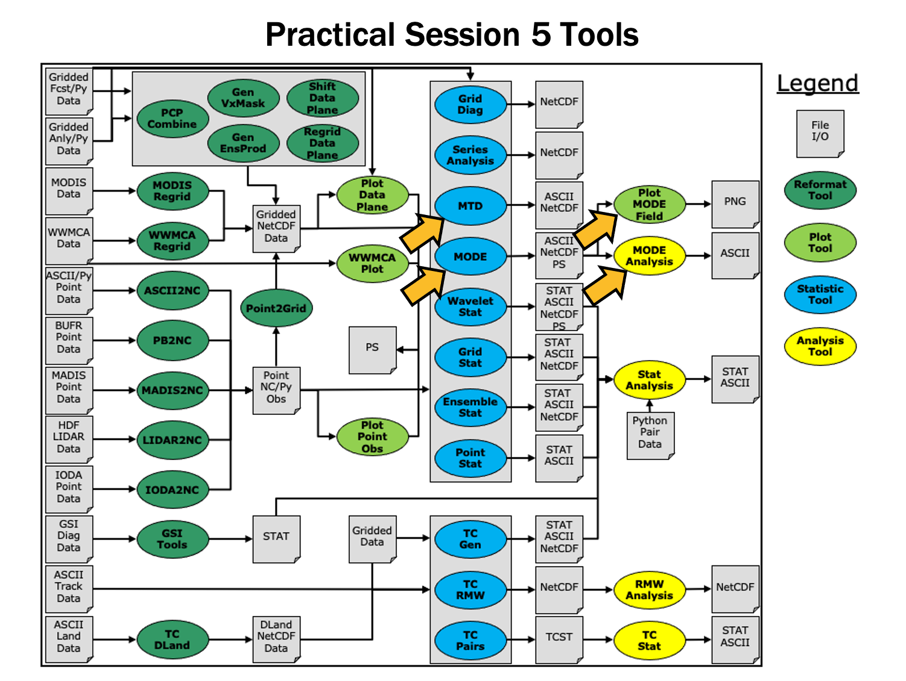

Session 5: MODE and MTD
=======================

**METplus Practical Session 5**

During this practical session, you will run the tools indicated below:

Since you already set up your runtime enviroment in Session 1, you should be ready to go! To be sure, run through the following instructions to check that your environment is set correctly.

**Prerequisites: Verify Environment is Set Correctly**

Before running the tutorial instructions, you will need to ensure that you have a few environment variables set up correctly. If they are not set correctly, the tutorial instructions will not work properly.

.. note::

   **1:** Navigate to your tutorial directory and run the tutorial setup script.

.. important::

   In the following instructions, change "/path/to" to the directory you chose.

**EDIT AFTER COPYING and BEFORE HITTING RETURN!**

.. code-block:: text

   cd /path/to/METplus-5.0.0_Tutorial
   source METplus-5.0.0_TutorialSetup.sh

.. note::

   **2:** Check that you have environment variables set correctly. If any of these variables are not set, navigate back to the METplus Setup section of the tutorial.

.. code-block:: text

   echo ${METPLUS_TUTORIAL_DIR}
   echo ${METPLUS_BUILD_BASE}
   echo ${MET_BUILD_BASE}
   echo ${METPLUS_DATA}
   ls ${METPLUS_TUTORIAL_DIR}
   ls ${METPLUS_BUILD_BASE}
   ls ${MET_BUILD_BASE}
   ls ${METPLUS_DATA}

.. important::

   **METPLUS_TUTORIAL_DIR** is the location of all of your tutorial work, including configuration files, output data, and any other notes you'd like to keep.
   **METPLUS_BUILD_BASE** is the full path to the METplus installation (/path/to/METplus-X.Y)
   **MET_BUILD_BASE** is the full path to the MET installation (/path/to/met-X.Y)
   **METPLUS_DATA** is the location of the sample test data directory

.. note::

   **3:** Check that the MET applications are in the path:

.. code-block:: text

   which point_stat

.. important::

   You should see the usage statement for Point-Stat. The version number listed should correspond to the version listed in **MET_BUILD_BASE **. If it does not, you will need to either reload the met module, or add **${MET_BUILD_BASE}/bin** to your PATH.

.. note::

   **4:** Check that the correct version of ** run_metplus.py ** is in your ** PATH**:

.. code-block:: text

   which run_metplus.py

.. important::

   If you don't see the full path to script from the shared installation, please set it. It should look the same as the output from this command:

.. code-block:: text

   echo ${METPLUS_BUILD_BASE}/ush/run_metplus.py
   ls ${METPLUS_BUILD_BASE}/ush/run_metplus.py

See the instructions in Session 1 for more information.
You are now ready to move on to the next section.

.. important::

   If you discover any typos, error in the run commands, incorrect output listed, or any other issues while completing the tutorial, you are encouraged to submit your findings to the METplus team in a `GitHub Discussions <https://github.com/dtcenter/METplus/discussions>`_. Be sure to provide what session and specific page you encountered the issue on.

MET Tool: MODE
--------------

**MODE FUNCTIONALITY**

MODE, the Method for Object-Based Diagnostic Evaluation, provides an object-based verification for comparing gridded forecasts to gridded observations. MODE may be used in a generalized way to compare any two fields containing data from which objects may be well defined. It has most commonly been applied to precipitation fields and radar reflectivity. The steps performed in MODE consist of:

* Define objects in the forecast and observation fields based on user-defined parameters.
* Compute attributes for each of those objects: such as area, centroid, axis angle, and intensity.
* For each forecast/observation object pair, compute differences between their attributes: such as area ratio, centroid distance, angle difference, and intensity ratio.
* Use fuzzy logic to compute a total interest value for each forecast/observation object pair based on user-defined weights.
* Based on the computed interest values, match objects across fields and merge objects within the same field.
* Write output statistics summarizing the characteristics of the single objects, the pairs of objects, and the matched/merged objects.

MODE may be configured to use a few different sets of logic with which to perform matching and merging. In this tutorial, we'll use the most simple approach, but users are encouraged to read the MODE chapter of the `MET User's Guide <https://metplus.readthedocs.io/projects/met/en/main_v11.1/Users_Guide/mode.html>`_ for a more thorough description of MODE's capabilities.

**MODE USAGE**

.. note::

   View the usage statement for MODE by simply typing the following:

.. code-block:: text

   mode

**Usage: mode**

.. list-table::
   :header-rows: 1
   :widths: 30 70

   * - Argument
     - Description
   * - ``fcst_file``
     - Input gridded forecast file containing the field to be verified
   * - ``obs_file``
     - Input gridded observation file containing the verifying field
   * - ``config_file``
     - MODEConfig file containing the desired configuration settings
   * - ``[-config_merge merge_config_file]``
     - Overrides the default fuzzy engine settings for merging within the fcst/obs fields (optional).
   * - ``[-outdir path]``
     - Overrides the default output directory (optional).
   * - ``[-log file]``
     - Outputs log messages to the specified file
   * - ``[-v level]``
     - Level of logging
   * - ``[-compress level]``
     - NetCDF compression level

.. important::

   The forecast and observation fields must be on the same grid. You can use **copygb ** to regrid GRIB1 files,** wgrib2** to regrid GRIB2 files, or use the automated regridding functionality within the MET config files.

.. important::

   The MODE tool usage statement also has instructions for verifying multivariables. These are the same as the MODE usage, only passing ASCII lists that contain multiple files instead of a single file.

At a minimum, the input gridded fcst_file, the input gridded obs_file, and the configuration config_file must be passed in on the command line.

Configure
^^^^^^^^^

.. note::

   Start by making an output directory for MODE and changing directories:

.. code-block:: text

   mkdir -p ${METPLUS_TUTORIAL_DIR}/output/met_output/mode
   cd ${METPLUS_TUTORIAL_DIR}/output/met_output/mode

The behavior of MODE is controlled by the contents of the configuration file passed to it on the command line. The default MODE configuration file may be found in the `data/config/MODEConfig_default <https://github.com/dtcenter/MET/blob/main_v11.0/data/config/MODEConfig_default>`_ file.

.. note::

   Prior to modifying the configuration file, users are advised to make copies of existing configuration files:

.. code-block:: text

   cp ${METPLUS_DATA}/met_test/scripts/config/MODEConfig_APCP_12 MODEConfig_APCP_12
   cp ${METPLUS_DATA}/met_test/scripts/config/MODEConfig_APCP_24 MODEConfig_APCP_24
   cp ${METPLUS_DATA}/met_test/scripts/config/MODEConfig_RH MODEConfig_RH

We'll be using these three configuration files during this session.

.. note::

   Open up the **MODEConfig_APCP_12** file to view it.

.. code-block:: text

   vi MODEConfig_APCP_12

The configuration items for MODE are used to specify how the object-based verification approach is to be performed. In MODE, as in the other MET statistics tools, you can compare any two fields. When necessary, the items in the configuration file are specified separately for the forecast and observation fields. In most cases though, users will be comparing the same forecast and observation fields. The configurable items include parameters for the following:

The forecast and observation fields and vertical levels or accumulation intervals to be compared

* Options to mask out a portion of or threshold the raw fields

The forecast and observation object definition parameters

* Options to filter out objects that don't meet a size or intensity criteria
* Flags to control the logic for matching/merging
* Weights to be applied for the fuzzy engine matching/merging algorithm
* Interest functions to be used for the fuzzy engine matching/merging algorithm

Total interest threshold for matching/merging

* Various plotting options

.. important::

   While the MODE configuration file contains many options, beginning users will typically only need to modify a few of them. You may find a complete description of the configurable items in the `mode configuration file <https://metplus.readthedocs.io/projects/met/en/main_v11.1/Users_Guide/mode.html#mode-configuration-file>`_ section of the MET User's Guide. Please take some time to review them.

.. note::

   At the bottom of MODE_Config_APCP_12, change "version" to "11.0"

.. admonition:: Sample Output

   .. code-block:: text

      ////////////////////////////////////////////////////////////////////////////////
      output_prefix = "";
      version = "V11.0";
      ////////////////////////////////////////////////////////////////////////////////

.. note::

   Close MODEConfig_APCP_12.  Also change the version number in MODEConfig_APCP_24 and MODEConfig_RH.

We'll start here using by running the configuration files we copied over, as-is.

Run
^^^

.. note::

   Next, run MODE three times on the command line using those three configuration files with the following commands:

.. code-block:: text

   mode \
   ${METPLUS_DATA}/met_test/out/pcp_combine/sample_fcst_12L_2005080712V_12A.nc \
   ${METPLUS_DATA}/met_test/out/pcp_combine/sample_obs_2005080712V_12A.nc \
   MODEConfig_APCP_12 \
   -outdir . \
   -v 2

.. code-block:: text

   mode \
   ${METPLUS_DATA}/met_test/data/sample_fcst/2005080700/wrfprs_ruc13_24.tm00_G212 \
   ${METPLUS_DATA}/met_test/out/pcp_combine/sample_obs_2005080800V_24A.nc \
   MODEConfig_APCP_24 \
   -outdir . \
   -v 2

.. code-block:: text

   mode \
   ${METPLUS_DATA}/met_test/data/sample_fcst/2005080700/wrfprs_ruc13_12.tm00_G212 \
   ${METPLUS_DATA}/met_test/data/sample_fcst/2005080712/wrfprs_ruc13_00.tm00_G212 \
   MODEConfig_RH \
   -outdir . \
   -v 2

If you receive error output during any of the MODE runs above that looks like the following:

.. admonition:: Sample Output

   .. code-block:: text

      ERROR :
      ERROR : check_met_version() -> The version number listed in the config file (V8.1) is not compatible with the current version of the code (V11.0.0).
      ERROR :

You will need to follow the previous instructions and make sure the version is set to V11.0 in all of the configuration files prior to re-running the commands.
These commands make use of sample data that's distributed with the MET tarball. They run MODE on 12-hour accumulated precipitation, 24-hour accumulated precipitation, and on a field of relative humidity.

Output
^^^^^^

The output of MODE typically consists of 4 files: 2 ASCII statistics files, 1 NetCDF object file, and 1 PostScript summary plot. The output of any of these files may be disabled using the appropriate MODE command line argument. In this example, the output is written to the current mode directory, as we requested on the command line.
The MODE output file naming convention is similar to that of the other MET tools. It contains timing information about the forecast being evaluated (forecast valid, lead, and accumulation times).

.. important::

   If MODE is rerun on the same fields but with a slightly different configuration, the new output will override the old output, unless it is redirected to a different directory using the **-outdir ** command line argument. Users can also edit the **output_prefix** in the MODE configuration file to customize the output file names.

The 4 MODE output files are described briefly below:

* The PostScript file ends in .ps and is described below.
* The NetCDF object file ends in _obj.nc and contains the object indices.
* The ASCII contingency table statistics file and ends in _cts.txt.
* The ASCII object statistics file ends in _obj.txt and contains all of the object and object comparison data.

.. note::

   You can use ghostview (gv) to look at the postscript file output from each of these three forecasts.

.. code-block:: text

   gv mode_240000L_20050808_000000V_240000A.ps &

.. important::

   If ghostview is not available, use **display ** to view the files.  Click on the image to get a command box, then use ** File -> Next** to move to the next page of the image.

.. note::

   There are multiple pages of output. Take a moment to look them over:

#. Page 1 summarizes the entire MODE run. Thumbnail images show the input data, resolved objects, and numbers identifying each object for both the forecast and observation fields. The color indicates object matching between the forecast and observation fields. Royal blue indicates an unmatched object. The object definition information is listed at the bottom of the page, and a sorted list of total object interest is listed on the right side.

#. Page 2 is an expanded view of the forecast thumbnail images.
#. Page 3 is an expanded view of the observation thumbnail images.
#. Page 4 has images showing the forecast objects with observation object outlines overlaid, and vice-versa.
#. Page 5 shows images and statistics for matching object clusters (i.e. one or more forecast objects matching one or more observation objects). These statistics also appear in the ASCII output from MODE.
#. When double-thresholding or fuzzy engine merging is enabled, additional PostScript pages are added to illustrate those methods.

.. note::

   You may view the output NetCDF file using **ncview**. Execute the following command to view the NetCDF object output of MODE:

.. code-block:: text

   ncview mode_120000L_20050807_120000V_120000A_obj.nc &

.. note::

   Click through the 2D variable names in the ncview window to see plots of the four object fields in the file (NOTE: if a window pops up informing you "the min and max are both...", just Click "OK" and then the field will render). The **fcst_obj_id ** and ** obs_obj_id ** contain the indices for the forecast and observation objects defined by MODE. The ** fcst_clus_id ** and ** obs_clus_id** contain indices for the matched cluster objects.

What are the benefits of spatial methods over traditional statistics? The weaknesses? What are some examples where an object-based verification would be inappropriate?

METplus Use Case: MODE
----------------------

The MODE use case utilizes the MET MODE tools.
Optional: Refer to the `MET Users Guide <https://metplus.readthedocs.io/projects/met/en/main_v11.1/Users_Guide/index.html>`_ for a description of the MET tools used in this use case.

Optional: Refer to A-Z Config Glossary section of the `METplus Users Guide <https://metplus.readthedocs.io/en/main_v5.1/Users_Guide/glossary.html>`_ for a reference to METplus variables used in this use case.

**REVIEW USE CASE CONFIGURATION FILE: MODE.CONF**

.. note::

   Open the file and look at all of the configuration variables that are defined.

.. code-block:: text

   less ${METPLUS_BUILD_BASE}/parm/use_cases/met_tool_wrapper/MODE/MODE.conf

.. important::

   Note that variables in **MODE.conf** reference other config variables that have been defined in other configuration files. For example:

.. admonition:: File Contents

   .. code-block:: text

      OBS_MODE_INPUT_DIR = {INPUT_BASE}/met_test/data/sample_fcst

This references INPUT_BASE which is the METplus tutorial configuration file ${METPLUS_TUTORIAL_DIR}/tutorial.conf. METplus config variables can reference other config variables even if they are defined in a config file that is read afterwards.

**RUN METPLUS**

.. note::

   Change to ${METPLUS_TUTORIAL_DIR}

.. code-block:: text

   cd ${METPLUS_TUTORIAL_DIR}

.. note::

   Run the following command:

.. code-block:: text

   run_metplus.py \
   ${METPLUS_BUILD_BASE}/parm/use_cases/met_tool_wrapper/MODE/MODE.conf \
   ${METPLUS_TUTORIAL_DIR}/tutorial.conf \
   config.OUTPUT_BASE=${METPLUS_TUTORIAL_DIR}/output/MODE

METplus is finished running when control returns to your terminal console and you see the following text:

.. admonition:: Sample Output

   .. code-block:: text

      INFO: METplus has successfully finished running as user.

**REVIEW THE OUTPUT FILES**

You should have output files in the following directories:

.. code-block:: text

   ls ${METPLUS_TUTORIAL_DIR}/output/MODE/mode/2005080712

.. admonition:: Sample Output

   .. code-block:: text

      mode_WRF_RH_vs_WRF_RH_P500_120000L_20050807_120000V_000000A_cts.txt
      mode_WRF_RH_vs_WRF_RH_P500_120000L_20050807_120000V_000000A_obj.nc
      mode_WRF_RH_vs_WRF_RH_P500_120000L_20050807_120000V_000000A_obj.txt
      mode_WRF_RH_vs_WRF_RH_P500_120000L_20050807_120000V_000000A.ps

.. note::

   Take a look at some of the files to see what was generated.

.. code-block:: text

   less ${METPLUS_TUTORIAL_DIR}/output/MODE/mode/2005080712/mode_WRF_RH_vs_WRF_RH_P500_120000L_20050807_120000V_000000A_obj.txt

**REVIEW THE LOG FILES**

Log files for this run are found in ${METPLUS_TUTORIAL_DIR}/output/MODE/logs/.

.. important::

   The filename contains a timestamp of when it was run, in format YYYYMMDDhhmmss. The most recent timestamp will be from running the MODE use case.

.. code-block:: text

   ls ${METPLUS_TUTORIAL_DIR}/output/MODE/logs/metplus.log.*

.. important::

   NOTE: If you ran METplus on a different day than today, the log file will correspond to the day you ran. Note that some computers, such as NOAA's hera are set to UTC.

**REVIEW THE FINAL CONFIGURATION FILE**

The final configuration files are found in ${METPLUS_TUTORIAL_DIR}/output/MODE. Similar to the log files, the configuration file contains a timestamp of the time that the METplus command was run.

.. code-block:: text

   ls ${METPLUS_TUTORIAL_DIR}/output/MODE/metplus_final.conf.*

MET Tool: MTD
-------------

**MODE-TIME-DOMAIN FUNCTIONALITY**

The MODE-Time-Domain (MTD) tool was added in MET version 6.0. It applies an object-based verification technique in comparing a gridded forecast to a gridded analysis. It defines 3-dimensional space/time objects, tracking 2-dimensional objects through time. It writes summary object information to ASCII statistics files and writes object fields to NetCDF format. The MTD tool can be used to quantify the duration of events and timing errors.

**MODE-TIME-DOMAIN USAGE**

.. note::

   View the usage statement for MODE-Time-Domain by simply typing the following:

.. code-block:: text

   mtd

.. important::

   The forecast and observation fields must be on the same grid. You can use **copygb ** to regrid GRIB1 files,** wgrib2** to regrid GRIB2 files, or use the automated regridding functionality within the MET config files.

At a minimum, the -fcst and -obs options must be used to specify the data to be processed. Alternatively, the -single option specifies that MTD should be run on a single dataset. The -config option specifies the name of the configuration file.

Configure
^^^^^^^^^

.. note::

   Start by making an output directory for MTD and changing directories:

.. code-block:: text

   mkdir -p ${METPLUS_TUTORIAL_DIR}/output/met_output/mtd
   cd ${METPLUS_TUTORIAL_DIR}/output/met_output/mtd

The behavior of MTD is controlled by the contents of the configuration file passed to it on the command line. The default MTD configuration file may be found in the `data/config/MTDConfig_default <https://github.com/dtcenter/MET/blob/main_v11.0/data/config/MTDConfig_default>`_ file.

.. note::

   Prior to modifying the configuration file, make a copy of the default:

.. code-block:: text

   cp ${MET_BUILD_BASE}/share/met/config/MTDConfig_default MTDConfig_tutorial

The configuration items for MTD are used to specify how the space-time-object-based verification approach is to be performed. Just as MODE may be used to compare any two fields, the same is true of MTD. When necessary, the items in the configuration file are specified separately for the forecast and observation fields. In most cases though, users will be comparing the same forecast and observation fields. The configurable items include specifications for the following:

* The verification domain.

The forecast and observation fields and vertical levels or accumulation intervals to be compared.
The forecast and observation object definition parameters.

* Options to filter out objects that don't meet a minimum volume.
* Matching/merging weights and interest functions.

Total interest threshold for matching/merging.

* Flags to control output files.

For this tutorial, we'll configure MTD to process the same series of data we ran through the Series-Analysis tool. Just like MODE, MTD compares a single forecast field to a single observation field in each run.

.. note::

   Open up the **MTDConfig_tutorial** file for editing with the text editor of your choice and edit it as follows:

.. code-block:: text

   vi MTDConfig_tutorial

.. note::

   Set the **fcst** dictionary as follows:

.. admonition:: File Contents

   .. code-block:: text

      fcst = {
         field = {
            name  = "APCP";
            level = "A03";
         }
         conv_radius = 2;
         conv_thresh = >=2.54;
      }

.. note::

   Set the **obs** dictionary as follows:

.. admonition:: File Contents

   .. code-block:: text

      obs = {
         field = {
            name  = "APCP_03";
            level = "(*,*)";
         }
         conv_radius = 2;
         conv_thresh = >=2.54;
      }

Set the minimum volume for MET evaluation to 0:

.. admonition:: File Contents

   .. code-block:: text

      min_volume = 0;

This retains all objects regardless of their calculated volume.

.. note::

   Save and close the configuration file.

Run
^^^

.. note::

   First, we need to prepare our observations by putting 1-hourly StageII precipitation forecasts into 3-hourly buckets. Create an output directory:

.. code-block:: text

   mkdir -p sample_obs/ST2ml_3h

.. note::

   Run the following PCP-Combine commands to prepare the observations:

.. code-block:: text

   pcp_combine -sum 00000000_000000 01 20050807_030000 03 \
   sample_obs/ST2ml_3h/sample_obs_2005080703V_03A.nc \
   -pcpdir ${METPLUS_DATA}/met_test/data/sample_obs/ST2ml

.. code-block:: text

   pcp_combine -sum 00000000_000000 01 20050807_060000 03 \
   sample_obs/ST2ml_3h/sample_obs_2005080706V_03A.nc \
   -pcpdir ${METPLUS_DATA}/met_test/data/sample_obs/ST2ml

.. code-block:: text

   pcp_combine -sum 00000000_000000 01 20050807_090000 03 \
   sample_obs/ST2ml_3h/sample_obs_2005080709V_03A.nc \
   -pcpdir ${METPLUS_DATA}/met_test/data/sample_obs/ST2ml

.. code-block:: text

   pcp_combine -sum 00000000_000000 01 20050807_120000 03 \
   sample_obs/ST2ml_3h/sample_obs_2005080712V_03A.nc \
   -pcpdir ${METPLUS_DATA}/met_test/data/sample_obs/ST2ml

.. code-block:: text

   pcp_combine -sum 00000000_000000 01 20050807_150000 03 \
   sample_obs/ST2ml_3h/sample_obs_2005080715V_03A.nc \
   -pcpdir ${METPLUS_DATA}/met_test/data/sample_obs/ST2ml

.. code-block:: text

   pcp_combine -sum 00000000_000000 01 20050807_180000 03 \
   sample_obs/ST2ml_3h/sample_obs_2005080718V_03A.nc \
   -pcpdir ${METPLUS_DATA}/met_test/data/sample_obs/ST2ml

.. code-block:: text

   pcp_combine -sum 00000000_000000 01 20050807_210000 03 \
   sample_obs/ST2ml_3h/sample_obs_2005080721V_03A.nc \
   -pcpdir ${METPLUS_DATA}/met_test/data/sample_obs/ST2ml

.. code-block:: text

   pcp_combine -sum 00000000_000000 01 20050808_000000 03 \
   sample_obs/ST2ml_3h/sample_obs_2005080800V_03A.nc \
   -pcpdir ${METPLUS_DATA}/met_test/data/sample_obs/ST2ml

Rather than listing 8 input forecast and observation files on the command line, we will write them to a file list first. Since the 0-hour forecast does not contain 3-hourly accumulated precip, we will exclude that from the list. We will use the 3-hourly APCP output from PCP-Combine that we prepared above:

.. code-block:: text

   ls -1 ${METPLUS_DATA}/met_test/data/sample_fcst/2005080700/wrfprs* | egrep -v "_00.tm00" > fcst_file_list
   ls -1 sample_obs/ST2ml_3h/sample_obs* > obs_file_list

.. note::

   Next, run the following MTD command:

.. code-block:: text

   mtd \
   -fcst fcst_file_list \
   -obs obs_file_list \
   -config MTDConfig_tutorial \
   -outdir . \
   -v 2

Just as with MODE, MTD applies a convolution operation to smooth the data. However, there are two important differences. In MODE, the convolution shape is a circle (radius = conv_radius). In MTD, the convolution shape is a square (width = 2*conv_radius+1) and for time t, the values in that square are averaged for times t-1, t, and t+1. Convolving in space plus time enables MTD to identify more continuous space-time objects.

.. important::

   If your data has high enough time frequency that the features at one timestep overlap those at the next timestep, it may be well-suited for MTD.

Output
^^^^^^

The MTD output typically consists of 6 files: 5 ASCII statistics files and 1 NetCDF object file. MTD does not create any graphical output. In this example, the output is written to the current mtd directory as we requested on the command line.

.. admonition:: Sample Output

   .. code-block:: text

      mtd_20050807_030000V_2d.txt
      mtd_20050807_030000V_3d_pair_cluster.txt
      mtd_20050807_030000V_3d_pair_simple.txt
      mtd_20050807_030000V_3d_single_cluster.txt
      mtd_20050807_030000V_3d_single_simple.txt
      mtd_20050807_030000V_obj.nc

The MTD output file naming convention begins with ``mtd_`` followed by the last valid time it encountered. The output file names may be modified using the output_prefix option in the configuration file, which should be used to prevent the output of one run from over-writing the output of a previous run. The 6 MTD output files are described briefly below:

* The NetCDF object file ends in .nc and contains gridded fields of the raw data, simple object indices, and cluster object indices for each forecast and observed timestep.
* The ASCII file ending with _2D.txt contains many columns similar to the output of MODE. This data summarizes the 2-dimensional object attributes for each individual time slice of the 3D forecast and observation objects.
* The ASCII files ending with _single_simple.txt and _single_cluster.txt contain 3D space-time attributes for simple and cluster objects, respectively.
* The ASCII files ending with _pair_simple.txt and _pair_cluster.txt contain 3D space-time attributes for pairs of simple and cluster objects, respectively.

.. note::

   Use the **ncview** utility to view the NetCDF object output of MTD:

.. code-block:: text

   ncview mtd_20050807_030000V_obj.nc &

.. note::

   Select the variable named **fcst_raw ** and click the ** time ** index to advance through the timesteps. Now, do the same for the ** fcst_object_id** variable.

Notice that the objects are defined in the active areas in the raw fields. Also notice some features merging (i.e. combining) as time passes while other features split (i.e. break apart). While they may be disconnected at a particular timestep, they remain part of the same space-time object.

.. note::

   Next, explore the ASCII output files and pay close attention to the header columns.

Notice the generalization of the 2D MODE object attributes to 3 dimensions. Area measure becomes volume. MTD measures the object speed. Each object has a beginning and ending time.

METplus Use Case: MTD
---------------------

**REFERENCE MATERIAL**

The MTD (Mode Time Domain) use case utilizes the MET MTD tools.
Optional: Refer to the `MET Users Guide <https://metplus.readthedocs.io/projects/met/en/main_v11.1/Users_Guide/index.html>`_ for a description of the MET tools used in this use case.

Optional: Refer to the A-Z Config Glossary section of the `METplus Users Guide <https://metplus.readthedocs.io/en/main_v5.1/Users_Guide/glossary.html>`_ for a reference to METplus variables used in this use case.

**REVIEW USE CASE CONFIGURATION FILE: MTD.CONF**

.. note::

   Open the file and look at all of the configuration variables that are defined.

.. code-block:: text

   less ${METPLUS_BUILD_BASE}/parm/use_cases/met_tool_wrapper/MTD/MTD.conf

Note that there are options to specify to run the tool with one file or two, depending on the science question being answered, as well configuration options for the settings regularly adjusted by users. For example:

.. admonition:: File Contents

   .. code-block:: text

      MTD_SINGLE_RUN = False
      MTD_SINGLE_DATA_SRC = OBS
      FCST_MTD_CONV_RADIUS = 0
      FCST_MTD_CONV_THRESH = >=10
      OBS_MTD_CONV_RADIUS = 15
      OBS_MTD_CONV_THRESH = >=1.0

Also note that there is a configuration option to run MTD variables in MTD.conf reference other config variables that have been defined in other configuration files. For example:

.. admonition:: File Contents

   .. code-block:: text

      OBS_MTD_INPUT_DIR = {INPUT_BASE}/met_test/new

This references INPUT_BASE which is set in the METplus data configuration file (metplus_config/metplus_data.conf). METplus config variables can reference other config variables even if they are defined in a config file that is read afterwards.

**RUN METPLUS**

.. note::

   Change to the $METPLUS_TUTORIAL_DIR directory:

.. code-block:: text

   cd ${METPLUS_TUTORIAL_DIR}

.. note::

   Run the following command:

.. code-block:: text

   run_metplus.py \
   ${METPLUS_BUILD_BASE}/parm/use_cases/met_tool_wrapper/MTD/MTD.conf \
   ${METPLUS_TUTORIAL_DIR}/tutorial.conf \
   config.OUTPUT_BASE=${METPLUS_TUTORIAL_DIR}/output/MTD

METplus is finished running when control returns to your terminal console and you see the following text:
INFO: METplus has successfully finished running as user.

**REVIEW THE OUTPUT FILES**

You should have output files including the following:

.. code-block:: text

   ls ${METPLUS_TUTORIAL_DIR}/output/MTD/mtd/2005080706

.. admonition:: Sample Output

   .. code-block:: text

      mtd_WRF_APCP_vs_MC_PCP_APCP_03_A03_20050807_060000V_2d.txt
      mtd_WRF_APCP_vs_MC_PCP_APCP_03_A03_20050807_060000V_3d_pair_cluster.txt
      mtd_WRF_APCP_vs_MC_PCP_APCP_03_A03_20050807_060000V_3d_pair_simple.txt
      mtd_WRF_APCP_vs_MC_PCP_APCP_03_A03_20050807_060000V_3d_single_cluster.txt
      mtd_WRF_APCP_vs_MC_PCP_APCP_03_A03_20050807_060000V_3d_single_simple.txt
      mtd_WRF_APCP_vs_MC_PCP_APCP_03_A03_20050807_060000V_obj.nc

Take a look at some of the files to see what was generated.

.. note::

   Open the output NetCDF file with ncview to look at the data:

.. code-block:: text

   ncview ${METPLUS_TUTORIAL_DIR}/output/MTD/mtd/2005080706/mtd_WRF_APCP_vs_MC_PCP_APCP_03_A03_20050807_060000V_obj.nc

.. note::

   Click on the buttons in the Var: section (i.e. fcst_raw) to view the fields.

.. note::

   Open an output text file to view the contents:

.. code-block:: text

   less ${METPLUS_TUTORIAL_DIR}/output/MTD/mtd/2005080706/mtd_WRF_APCP_vs_MC_PCP_APCP_03_A03_20050807_060000V_3d_single_simple.txt

**REVIEW THE LOG FILES**

Log files for this run are found in ${METPLUS_TUTORIAL_DIR}/output/MTD/logs. The filename contains a timestamp of the current year, month, day, hour, minute, and second.

.. code-block:: text

   ls ${METPLUS_TUTORIAL_DIR}/output/MTD/logs/metplus.log.*

.. important::

   NOTE: If you ran METplus on a different day than today, the log file will correspond to the day you ran.

**REVIEW THE FINAL CONFIGURATION FILE**

The final configuration files are found in${METPLUS_TUTORIAL_DIR}/output/MTD. Similar to the log files, the configuration file contains a timestamp of the time that the METplus command was run.

.. code-block:: text

   ls ${METPLUS_TUTORIAL_DIR}/output/MTD/metplus_final.conf.*

End of Session 5 and Additional Exercises
-----------------------------------------

Congratulations! You have completed Session 5!
If you have extra time, you may want to try these additional METplus exercises.

EXERCISE 5.1: Change Forecast Lead List to Using Intervals

.. note::

   **Instructions:** Modify the METplus configuration files to change the forecast leads that are processed by MTD. Following these instructions will give you more insight on how METplus configures MTD.

.. note::

   To do this, copy your MTD configuration file and rename it to mtd.skip.conf for this exercise.

.. code-block:: text

   cp \
   ${METPLUS_BUILD_BASE}/parm/use_cases/met_tool_wrapper/MTD/MTD.conf \
   $METPLUS_TUTORIAL_DIR/user_config/mtd.skip.conf

.. note::

   Open mtd.skip.conf with an editor to change forecast lead values and add an additional lead time.

.. code-block:: text

   vi ${METPLUS_TUTORIAL_DIR}/user_config/mtd.skip.conf

.. note::

   Change LEAD_SEQ to process the same forecasts but using an increment rather than listing the explicit values

.. note::

   LEAD_SEQ = begin_end_incr(6, 15, 3)

.. note::

   Close the file and rerun master_metplus passing in your new custom config file for this exercise and changing **OUTPUT_BASE** to a new location so you can keep it separate from the other runs.

.. code-block:: text

   run_metplus.py \
   ${METPLUS_TUTORIAL_DIR}/user_config/mtd.skip.conf \
   ${METPLUS_TUTORIAL_DIR}/tutorial.conf \
   config.OUTPUT_BASE=${METPLUS_TUTORIAL_DIR}/output/exercises/mtd_skip

Did you see the WARNING message?

.. note::

   *WARNING: Could not find OBS file /d1/projects/METplus/METplus_Data/met_test/new/ST2ml2005080715_A03h.nc using template ST2ml{valid?fmt=%Y%m%d%H}_A03h.nc*

If you look in the data directories for this run, you will see that while the forecast for the 15 hour lead exists, the observation file does not. METplus will only add items to the MTD lists if both corresponding files are available.

.. code-block:: text

   ls -1 ${METPLUS_DATA}/met_test/data/sample_fcst/2005080700
   ls -1 ${METPLUS_DATA}/met_test/new/ST2*

.. note::

   Now look at the file lists that were generated by METplus for MTD

.. code-block:: text

   less ${METPLUS_TUTORIAL_DIR}/output/exercises/mtd_skip/stage/file_lists/20050807060000_mtd_fcst_APCP.txt

.. code-block:: text

   less ${METPLUS_TUTORIAL_DIR}/output/exercises/mtd_skip/stage/file_lists/20050807060000_mtd_obs_APCP_03.txt

.. note::

   Check the log file for any differences from the last run that processed forecast leads 6, 9, and 12 hour.

.. code-block:: text

   ls ${METPLUS_TUTORIAL_DIR}/output/exercises/mtd_skip/logs/metplus.log.*

EXERCISE 5.2: Change Forecast Lead List to See METplus Unzip

.. note::

   **Instructions:** Modify the METplus configuration files to change the forecast leads that are processed by MTD. Following these instructions will give you more insight on how METplus configures MTD.

.. note::

   To do this, copy your MTD configuration file and rename it to mtd.unzip.conf for this exercise.

.. code-block:: text

   cp ${METPLUS_BUILD_BASE}/parm/use_cases/met_tool_wrapper/MTD/MTD.conf ${METPLUS_TUTORIAL_DIR}/user_config/mtd.unzip.conf

.. note::

   Open mtd.unzip.conf with an editor and change the LEAD_SEQ to process forecast leads 3 and 6 hours.

.. code-block:: text

   vi ${METPLUS_TUTORIAL_DIR}/user_config/mtd.unzip.conf

.. admonition:: File Contents

   .. code-block:: text

      LEAD_SEQ = 3H, 6H

.. note::

   Close the file and rerun METplus, passing in your new custom config file and **OUTPUT_BASE** for this exercise

.. code-block:: text

   run_metplus.py \
   ${METPLUS_TUTORIAL_DIR}/user_config/mtd.unzip.conf \
   ${METPLUS_TUTORIAL_DIR}/tutorial.conf \
   config.OUTPUT_BASE=${METPLUS_TUTORIAL_DIR}/output/exercises/unzip

.. note::

   Now look at the file list that were generated by METplus for MTD observation files

.. code-block:: text

   less ${METPLUS_TUTORIAL_DIR}/output/exercises/unzip/stage/file_lists/20050807030000_mtd_obs_APCP_03.txt

Notice that the path of the 3 hour file is under your ${METPLUS_TUTORIAL_DIR}, while the 6 hour file is under ${METPLUS_DATA}.  If you look in the data directories for this run, you will see that the 3 hour observation file is gzipped in ${METPLUS_DATA}.

.. code-block:: text

   ls -1 ${METPLUS_DATA}/met_test/new/ST2*

METplus can recognize that files with gz, bzip2, or zip extensions are compressed and will do so automatically, placing the uncompressed file in the staging directory so that METplus doesn't modify any data in the input directory. METplus can be configured to scrub the staging directory after the run completes to save space, or leave the files so that they may be used by subsequent METplus runs without having to uncompress again (See SCRUB_STAGING_DIR and STAGING_DIR in the `METplus User's Guide <https://metplus.readthedocs.io/en/main_v5.1/Users_Guide/glossary.html>`_).

